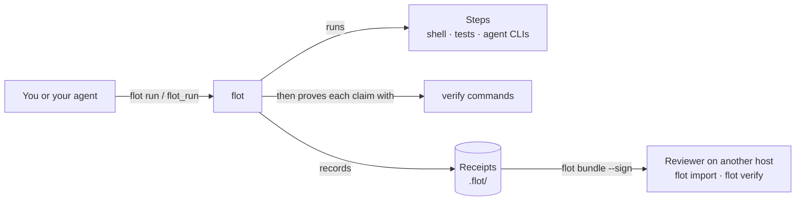

<div align="center">

**English** · [한국어](docs/readme/README_ko.md)

# flot

### Verifiable flows for coding agents.

**An agent says it is done. flot keeps the receipt that proves it.**

*flot = **flo**w + bo**t***

[](https://github.com/tobilife/flot/actions/workflows/ci.yml)
[](LICENSE)
[](Cargo.toml)
[](docs/architecture.md#current-scope)
[](docs/mcp.md)

[Quick start](#quick-start) · [How flot works](#how-flot-works) · [What flot guarantees](#what-flot-guarantees) · [Example flows](#example-flows) · [FAQ](#faq) · [Documentation](#documentation)

<code>cargo install flot-cli</code>

</div>

---

Coding agents report success in prose: "implemented, all tests pass". flot
turns that into evidence. You declare the work as a small flow of steps (shell
commands, test suites, agent CLIs), and flot runs it, records a
content-addressed **receipt** for every step, and checks every claim with a
command the agent did not write.

One rule is enforced by the runtime, not by prompt text:

> **A claim is unverified until an independent command proves it.**
> A run with unproven claims can never report `passed`.

Receipts are reused when nothing they depend on changed, so a second run costs
nothing. They can be bundled, signed and handed to a reviewer on another
machine, who can check them without trusting the agent or its host. flot is one
binary with one `flot.toml` and one `.flot/` directory, usable from your
terminal and from any agent that speaks MCP.

## Quick start

### Install

With [Rust](https://rustup.rs) 1.88 or later:

```bash
cargo install flot-cli
```

The crate is `flot-cli`; the command it installs is `flot`. For the latest
`main` instead of the latest release, use
`cargo install --git https://github.com/tobilife/flot`.

### Connect your agent (MCP)

```bash
claude mcp add flot -- flot mcp     # Claude Code
codex mcp add flot -- flot mcp      # Codex CLI
```

Restart the agent in a project that has a `flot.toml` (`flot init` writes a
starter one). Then try asking it:

```text
Fix the failing test. When you are done, run flot_run and show me the verdict
and any claim that is not verified.
```

The agent gets tools to plan, run, show, verify and compare runs. A run whose
claims were not proven comes back as `unverified`, not as a tool error, so the
agent cannot mistake a missing proof for a glitch. See [MCP server](docs/mcp.md)
for every tool and its contract.

### Use flot from the terminal (CLI)

```bash
flot init        # write a starter flot.toml
flot plan        # what would run, what would be reused, which claims lack proof
flot run         # execute and record receipts
flot show        # steps, claims and limitations of the latest run
```

This repository gates itself with flot ([`flot.toml`](flot.toml)):

```
$ flot run --force
ran      format               ok        172ms  claims 1v/0u/0r  receipt d072287e3975
ran      build                ok        775ms  claims 1v/0u/0r  receipt 009c7a066fc5
ran      lint                 ok        746ms  claims 1v/0u/0r  receipt 4c48096a2112
ran      test                 ok        5464ms  claims 2v/0u/0r  receipt 41311fb492f4

PASSED 1795501497928-ee2a0bae7a0c  root ee2a0bae7a0c  15352ms

$ flot run     # nothing changed: receipts are reused and the root is identical
cached   format               ok        172ms  claims 1v/0u/0r  receipt d072287e3975
cached   build                ok        775ms  claims 1v/0u/0r  receipt 009c7a066fc5
cached   lint                 ok        746ms  claims 1v/0u/0r  receipt 4c48096a2112
cached   test                 ok        5464ms  claims 2v/0u/0r  receipt 41311fb492f4

PASSED 1795501513323-ee2a0bae7a0c  root ee2a0bae7a0c  397ms
```

`1v/0u/0r` counts verified, unverified and refuted claims. See the
[CLI reference](docs/cli.md) for every command, run selectors, `--json` and
exit codes.

## How flot works



A step declares what it runs, what it reads, what it asserts and how that is
proved:

```toml
[flow]
name = "release-candidate"
budget = { timeout_secs = 900 }

[[step]]
id = "implement"
run = "claude -p 'implement .flot-work/spec.md'"
needs = ["spec"]
inputs = [".flot-work/spec.md"]
outputs = ["src/**/*.rs"]
claims = ["the workspace still compiles after the agent's edits"]
verify = "cargo build --all-targets --quiet"
```

flot derives a **step key** from the command, the content of every input, the
proof and the receipts of upstream steps. If the key is unchanged, the earlier
receipt is reused and its output files are restored. Otherwise the step runs,
its proof runs after it, and a new receipt is sealed: the receipt id is the
digest of what happened, so an edited receipt stops authenticating. The run's
verdict is `failed`, `unverified` or `passed`, in that order of precedence.

[Writing flows](docs/flows.md) covers every field: keys, receipts, claims,
budgets, concurrency, outputs and guarded proofs.

## What flot guarantees

- **No proof, no pass.** A claim is `verified` only when its proof command ran
  after the step succeeded and exited zero. A failed, timed-out, killed or
  tolerated step proves nothing, and a proof whose files changed while it ran
  does not count.
- **Receipts you can check.** Every receipt re-hashes to its own id, and a run's
  verdict and root digest are recomputed from its receipts, never read.
  `flot verify` re-reads every stored byte.
- **Reuse you can trust.** A cache hit requires the same command over the same
  input content and the same upstream receipts, sealed by this host. Failures
  are never cached.
- **Evidence that travels.** `flot bundle --sign` produces one file a reviewer
  can import and verify. Imported receipts stand in for local work only when a
  signer the reviewer trusts signed them, and only while that trust lasts.
- **Bounded runs.** Timeouts and output limits stop work and say so; a cost
  ceiling stops starting steps once agents have reported that much spend.
- **One contract.** The CLI and the MCP server call the same functions, so a
  human and an agent see the same receipts, verdicts and digests.

[Evidence, bundles and trust](docs/evidence.md) explains signing, the trust
list and the `.flot` store.

## Example flows

| Flow | What it shows |
|---|---|
| [`examples/slugify`](examples/slugify/flot.toml) | One agent implements a spec, a check no agent wrote proves it, a second agent reviews. Run end to end against Claude Code; [the full story](docs/agents.md#a-real-run-end-to-end) includes the bug it caught in flot itself. |
| [`examples/agent-review.toml`](examples/agent-review.toml) | A spec, an implementation and a review as three agent steps; the project's tests prove the implementation. |
| [`examples/parallel-review.toml`](examples/parallel-review.toml) | Three independent agent reviewers (security, performance, contracts) of the current diff, run concurrently, then a test gate. |
| [`flot.toml`](flot.toml) | This repository's own gate: format, build, lint and test, each with a proof. |

Copy an example to your project root before running it: paths and the `.flot`
store are relative to the flow file. [Running coding agents](docs/agents.md)
covers agent steps and spend accounting.

## FAQ

<details>
<summary><strong>Is flot a plugin for Claude Code or Codex?</strong></summary>

No. flot is a standalone binary. It works with any agent in two directions: the
agent calls flot through MCP (`flot mcp`), or flot calls the agent as a step
(`claude -p …`, `codex exec …`). It installs no hooks, prompts or agent
definitions; it judges work from outside the agent.

</details>

<details>
<summary><strong>Which agents can use flot?</strong></summary>

Any agent that supports local MCP servers over stdio, and any agent with a
command-line interface for use inside steps. Registration for Claude Code and
Codex is shown above; see [MCP server](docs/mcp.md) for the protocol details.

</details>

<details>
<summary><strong>Does flot sandbox the steps it runs?</strong></summary>

No. A step runs with your user's permissions and environment. flot records and
judges what steps did; it does not confine them. Run flows you have read, and
an agent with the permissions you would give it anyway.

</details>

<details>
<summary><strong>Why is my run <code>unverified</code>?</strong></summary>

At least one claim has no proof that settled it: the step has no `verify`
command, the step failed or was tolerated with `allow_failure`, or the proof
timed out, was killed, or saw its files change. `flot show` names each
unverified claim, and `flot plan` lists claims that lack a proof before you
run anything.

</details>

<details>
<summary><strong>Does flot send my code anywhere?</strong></summary>

No. flot runs locally and has no network code. Agents you run as steps talk to
their own providers under their own data policies.

</details>

<details>
<summary><strong>Does it work on Windows?</strong></summary>

Not yet tested. Process-group cancellation uses POSIX signals; CI runs on Linux
and macOS.

</details>

<details>
<summary><strong>What should I do if I hit a bug?</strong></summary>

Update with `cargo install flot-cli` and retry. If it persists, [open an issue](https://github.com/tobilife/flot/issues)
with `flot --version`, the flow file, the command you ran and its output.

</details>

## Documentation

- [Writing flows](docs/flows.md): steps, keys, receipts, claims, budgets, concurrency, outputs and guarded proofs.
- [CLI reference](docs/cli.md): commands, selecting runs and flows, `--json` and exit codes.
- [MCP server](docs/mcp.md): registration, tools, replies, errors and cancellation.
- [Running coding agents](docs/agents.md): an end-to-end agent run, spend and the cost ceiling.
- [Evidence, bundles and trust](docs/evidence.md): bundles, signing, the trust list and the `.flot` store.
- [Architecture](docs/architecture.md): layers, enforced dependency rules and current scope.

Report vulnerabilities through [SECURITY.md](SECURITY.md).

## Contributing

[Open an issue](https://github.com/tobilife/flot/issues) to report a bug or
suggest a feature, or [send a pull request](https://github.com/tobilife/flot/pulls).
See [CONTRIBUTING.md](CONTRIBUTING.md) for development setup and checks.

## License

[MIT](LICENSE)
