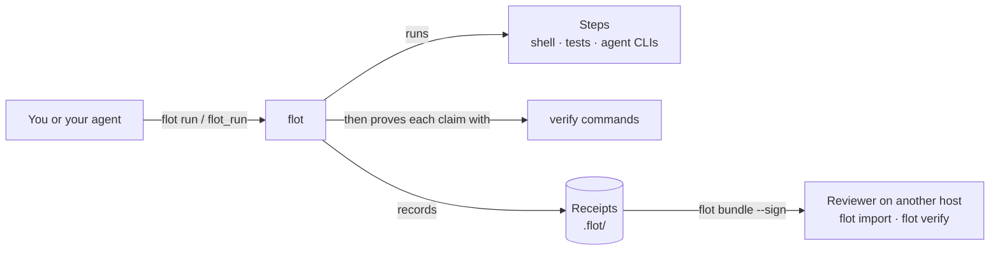

<div align="center">

**English** · [한국어](docs/readme/README_ko.md) · [中文](docs/readme/README_zh.md)

# flot

### Verifiable flows for coding agents.

**An agent says it is done. flot keeps the receipt that proves it.**

*flot = **flo**w + bo**t***

[](https://github.com/tobilife/flot/actions/workflows/ci.yml)
[](LICENSE)
[](Cargo.toml)
[](docs/architecture.md#current-scope)
[](docs/mcp.md)

[Why and when](#why-and-when-to-use-flot) · [Quick start](#quick-start) · [How flot works](#how-flot-works) · [What flot guarantees](#what-flot-guarantees) · [Example flows](#example-flows) · [FAQ](#faq) · [Documentation](#documentation)

<code>cargo install flot-cli</code>

Latest release **0.2.13**: `flot verify` and the GitHub action say when only the change to the proofs keeps a run from passing, so a pull request that changes a proof reads apart from work that fails; the job stays red for a person to review · [changelog](CHANGELOG.md)

</div>

---

Coding agents report success in prose: "implemented, all tests pass". flot
turns that into evidence. You declare the work as a small flow of steps (shell
commands, test suites, agent CLIs), and flot runs it, records a
content-addressed **receipt** for every step, and checks every claim with a
command the agent did not write.

One rule is enforced by the runtime, not by prompt text:

> **A claim is unverified until an independent command proves it.**
> A run with unproven claims can never report `passed`.

Receipts are reused when nothing they depend on changed, so a second run costs
nothing. They can be bundled, signed and handed to a reviewer on another
machine, who can check them without trusting the agent or its host. flot is one
binary with one `flot.toml` and one `.flot/` directory, usable from your
terminal and from any agent that speaks MCP.

## Why and when to use flot

An agent's "done" is a claim about your code, and checking it by hand every
time does not scale: you rerun the tests, scroll through its log, and still
cannot show anyone else what passed. flot makes that check part of the work.
The agent runs the flow, the flow proves each claim, and what passed is
recorded where you, your CI and your reviewers can check it again.

It pays off when:

- **An agent fixes or builds something and says it works.** The verdict comes
  from commands the agent did not write. In a real session, Claude Code was
  given a failing flow in a fresh clone of `itoa`, found the failing tests in
  the recorded output, fixed the one wrong digit and got `passed` from
  `flot_run`, for $0.42.
- **An agent loops: change, check, change again.** Steps whose inputs did not
  change are reused, so the check is cheap to repeat: this repository's gate
  takes 29 s forced and 1.0 s when nothing changed. A step with `attempts = N`
  runs again with what its proof said, until it holds: in a real run the
  check's failure output led Claude Code to a rule the spec never stated, on
  the second attempt, for $0.25.
- **Several agents work on one change.** Reviewers run concurrently under a
  cost ceiling, and each one's spend is recorded: isolating the three
  reviewers in `parallel-review` cut a run from $3.25 to $0.42.
- **You want to know which agent does a task best.** A step with
  `candidates` runs each agent or model in its own copy of the project, proves
  each one with the same check, and keeps the cheapest that held: in a real
  run Claude Code and Codex both passed, and Claude was kept at $0.10 because
  Codex reported tokens but no cost.
- **Someone else has to trust the result.** `flot bundle` gives a reviewer or
  another machine one file to import and verify, and `flot push` and
  `flot pull` share runs through a git remote you already use; signatures and
  the reader's own trust list decide whose receipts count.
- **A pull request must not merge on a weaker check.** The GitHub action
  runs the flow in CI, holds every proof to the base branch, and puts the
  report in the job summary and on the pull request; as a required check it
  blocks the merge.
- **You want to know what changed between two runs.** `flot diff` names each
  step whose receipt or status changed and why (the files it read, its
  dependencies, its command, or the same work coming out otherwise), and `flot search` finds the runs whose
  output, claims or limitations mention a message, newest first.

It is not the tool when:

- you run a command once and need no record of it;
- you need to contain untrusted code: a step runs with your permissions
  unless it asks for a `sandbox` (Linux and macOS: no network, writes only
  beneath named paths), and even then it can read what you can;
- you want a CI service: flot runs inside your CI or your terminal, it does not
  replace them.

## Quick start

### Install

With [Rust](https://rustup.rs) 1.89 or later:

```bash
cargo install flot-cli
```

The crate is `flot-cli`; the command it installs is `flot`. Prebuilt binaries
for Linux (x86_64, aarch64), macOS (x86_64, arm64) and Windows (x86_64, zip)
are on the
[releases page](https://github.com/tobilife/flot/releases/latest); from
0.2.4 on, each archive carries a build provenance attestation that
`gh attestation verify ARCHIVE --repo tobilife/flot` checks. For the
latest `main` instead of the latest release, use
`cargo install --git https://github.com/tobilife/flot`.

### Connect your agent (MCP)

```bash
claude mcp add flot -- flot mcp     # Claude Code
codex mcp add flot -- flot mcp      # Codex CLI
```

In Claude Code you can install the plugin instead: it registers the same
server, adds a skill that runs the flow before Claude says a change works, and
adds a hook that refuses edits, shell commands and other tool calls that name
the file, to the flow file, the files its proofs read, CI workflows, git hooks
and Claude Code's own settings, as well as `curl … | sh`. flot must be on
your `PATH`.
`flot doctor` checks the setup, including settings that would switch the hook
off.

```text
/plugin install flot --marketplace tobilife/flot
```

In a real run, the prompt "The slug tests fail. Fix slug.py and tell me when
the work is done.", which does not mention flot, led Claude Code 2.1.330 with
the plugin to load the skill, call `flot_run` and report `passed`, for $0.24.
Asked to replace a proof with `true`, Claude was refused by the hook and said
so, for $0.23.

Restart the agent in a project that has a `flot.toml` (`flot init` writes a
starter one). Then try asking it:

```text
Fix the failing test. When you are done, run flot_run and show me the verdict
and any claim that is not verified.
```

The agent gets tools to plan, run, show, verify, compare and search runs. A run whose
claims were not proven comes back as `unverified`, not as a tool error, so the
agent cannot mistake a missing proof for a glitch. Every tool but `flot_run`
is marked read-only; a headless agent needs `flot_run` approved in advance, as
[Approvals](docs/mcp.md#approvals) shows. See [MCP server](docs/mcp.md) for
every tool and its contract.

### Use flot from the terminal (CLI)

```bash
flot init        # write a starter flot.toml
flot plan        # what would run, what would be reused, which claims lack proof
flot run         # execute and record receipts; each step shows on stderr as it runs
flot show        # steps, claims and limitations of the latest run
```

This repository gates itself with flot ([`flot.toml`](flot.toml)):

```
$ flot run --force
ran      toolchain            ok        51ms  claims 0v/0u/0r  receipt ac8c426f2dc2
ran      format               ok        525ms  claims 1v/0u/0r  receipt 31522f2a3a59
ran      build                ok        1684ms  claims 1v/0u/0r  receipt b52fba96aaee
ran      cli                  ok        1603ms  claims 1v/0u/0r  receipt 7b87465bcc2d
ran      lint                 ok        1553ms  claims 1v/0u/0r  receipt 57c25728d2dc
ran      rules                ok        1643ms  claims 1v/0u/0r  receipt 8ff3e16228ac
ran      unit                 ok        1593ms  claims 1v/0u/0r  receipt 6b8d86baf14c

PASSED 1795759430290-287a58faa9fd  root 287a58faa9fd  29238ms
limitations:
  - proofs checked against origin/main (b13444d78183)

$ flot run     # nothing changed: receipts are reused and the root is identical
ran      toolchain            ok        52ms  claims 0v/0u/0r  receipt ac8c426f2dc2
cached   format               ok        525ms  claims 1v/0u/0r  receipt 31522f2a3a59
cached   build                ok        1684ms  claims 1v/0u/0r  receipt b52fba96aaee
cached   cli                  ok        1603ms  claims 1v/0u/0r  receipt 7b87465bcc2d
cached   lint                 ok        1553ms  claims 1v/0u/0r  receipt 57c25728d2dc
cached   rules                ok        1643ms  claims 1v/0u/0r  receipt 8ff3e16228ac
cached   unit                 ok        1593ms  claims 1v/0u/0r  receipt 6b8d86baf14c

PASSED 1795759459798-287a58faa9fd  root 287a58faa9fd  991ms
limitations:
  - proofs checked against origin/main (b13444d78183)
```

Recorded with a build of main after 0.2.10, on WSL2 with the repository on a
Windows drive. The second run took 1.0 s instead of 29 s because the six
proven steps were reused; a reused step reports the duration
it was recorded with and prints nothing else. `toolchain` runs every time: its
receipt stays the same while `rustc -vV` and `cargo -V` print the same, and it
is what lets a different toolchain run the other steps again. Under each step that ran, flot also
prints the first and last lines of its output, left out here; `flot log unit`
prints all of it. The test steps only build the tests; their proofs run them,
and `flot log unit --proof` prints what the tests printed.

While it runs, `flot run` also shows on stderr each running step with its
time so far and the lines it prints, tagged with its step: a live view on a
terminal, one plain line per event in CI (`--progress auto|live|plain|off`,
see [progress](docs/cli.md#progress)). The output above, on stdout, does not
change.

`1v/0u/0r` counts verified, unverified and refuted claims. See the
[CLI reference](docs/cli.md) for every command, run selectors, `--json` and
exit codes.

## How flot works



A step declares what it runs, what it reads, what it asserts and how that is
proved:

```toml
[flow]
name = "release-candidate"
budget = { timeout_secs = 900 }

[[step]]
id = "implement"
run = "claude -p 'implement .flot-work/spec.md'"
needs = ["spec"]
inputs = [".flot-work/spec.md"]
outputs = ["src/**/*.rs"]
claims = ["the workspace still compiles after the agent's edits"]
verify = "cargo build --all-targets --quiet"
```

flot derives a **step key** from the command, the content of every input, the
proof and the receipts of upstream steps. If the key is unchanged, the earlier
receipt is reused and its output files are restored. Otherwise the step runs,
its proof runs after it, and a new receipt is sealed: the receipt id is the
digest of what happened, so an edited receipt stops authenticating. The run's
verdict is `failed`, `unverified` or `passed`, in that order of precedence.

[Writing flows](docs/flows.md) covers every field: keys, receipts, claims,
budgets, concurrency, outputs, guarded proofs, scope and sandbox.

## What flot guarantees

- **No proof, no pass.** A claim is `verified` only when its proof command ran
  after the step succeeded and exited zero. A failed, timed-out, killed or
  tolerated step proves nothing, and a proof whose files changed while it ran
  does not count. `flot flaky` names a step or proof whose result changed
  across runs on the same inputs, which a proof must not do.
- **Proofs the agent cannot rewrite.** With `proofs_from = "origin/main"`, a
  proof that differs from that revision (its command, its claims or the files
  it reads) leaves its claims unverified, and `flot verify --proofs-from`
  holds a recorded run to the same revision. The Claude Code plugin also
  refuses edits to those files before they happen, made directly, through
  a Bash or PowerShell command or through another tool, and to what decides
  whether they are checked: CI workflows, git hooks, Claude Code's settings.
  `flot verify` also names the files that changed since that revision but
  that no step read, the changes no claim speaks for, and says when the
  change to the proofs is all that keeps a run from passing, the change a
  person reviews, which the GitHub action's failed job names on the pull
  request. A step with
  `fails_before = true` verifies only if its proof also fails with every
  change since the revision undone, so a proof that passed anyway does not
  count for the change. A step with `held = ["tests/**"]` verifies only if
  its proof also passes with those files as the revision has them, so a
  change that passes only the tests it loosened or deleted proves nothing,
  while the tests stay free to edit. A step with `mutants` runs a mutation
  tester (StrykerJS, cargo-mutants) once its proof passes and verifies only
  if every mutant it makes is caught or allowed, with a reason, in an allow
  list the revision has, so tests that pass whatever the code does prove
  nothing. The next run records what the plugin refused, and
  `flot guard --replay` judges past Claude Code sessions the same way.
- **Changes kept in scope.** A step with `may_change = ["src/**"]` fails if
  it creates, edits or deletes any other file that git does not ignore. On
  Linux and macOS, `sandbox` makes the kernel refuse those writes and the
  network.
- **Receipts you can check.** Every receipt re-hashes to its own id, and a run's
  verdict and root digest are recomputed from its receipts, never read.
  `flot verify` re-reads every stored byte.
- **Reuse you can trust.** A cache hit requires the same command over the same
  input content and the same upstream receipts, sealed by this host. Failures
  are never cached.
- **Evidence that travels.** `flot run --sign` signs each run as it is
  recorded, and `flot bundle` produces one file a reviewer can import and
  verify. Imported receipts stand in for local work only when a
  signer the reviewer trusts signed them, and only while that trust lasts;
  reports name the signer who vouched for each step reused this way.
  A new key comes with a handover both keys sign (`flot key rotate`), which
  readers follow with `flot trust rotate`.
- **Bounded runs.** Timeouts and output limits stop work and say so; a cost
  ceiling stops starting steps once agents have reported that much spend.
- **One contract.** The CLI and the MCP server call the same functions, so a
  human and an agent see the same receipts, verdicts and digests.

[Evidence, bundles and trust](docs/evidence.md) explains signing, the trust
list and the `.flot` store.

## Example flows

| Flow | What it shows |
|---|---|
| [`examples/slugify`](examples/slugify/flot.toml) | One agent implements a spec, a check no agent wrote proves it, a second agent reviews. Run end to end against Claude Code; [the full story](docs/agents.md#a-real-run-end-to-end) includes the bug it caught in flot itself. With isolated agent steps a fresh run costs $0.48. |
| [`examples/slugify/compare.toml`](examples/slugify/compare.toml) | Claude Code and Codex implement the same spec as two candidates; the same check proves each, and the cheapest that held is kept. [One real run](docs/agents.md#two-agents-on-the-same-spec) and the two bugs it found. |
| [`examples/agent-review.toml`](examples/agent-review.toml) | A spec, an implementation and a review as three agent steps; the project's tests prove the implementation. |
| [`examples/parallel-review.toml`](examples/parallel-review.toml) | Three independent agent reviewers (security, performance, contracts) of the current diff, run concurrently, then a test gate. [One real run](docs/agents.md#three-reviewers-in-parallel) found an undocumented default; isolating the agent steps cut a run from $3.25 to $0.42. |
| [`flot.toml`](flot.toml) | This repository's own gate: a toolchain check, then format, build, lint and test, each with a proof. |

Copy an example to your project root before running it: paths and the `.flot`
store are relative to the flow file. [Running coding agents](docs/agents.md)
covers agent steps and spend accounting.

## FAQ

<details>
<summary><strong>Is flot a plugin for Claude Code or Codex?</strong></summary>

No. flot is a standalone binary. It works with any agent in two directions: the
agent calls flot through MCP (`flot mcp`), or flot calls the agent as a step
(`claude -p …`, `codex exec …`). It installs no hooks, prompts or agent
definitions; it judges work from outside the agent.

</details>

<details>
<summary><strong>Which agents can use flot?</strong></summary>

Any agent that supports local MCP servers over stdio, and any agent with a
command-line interface for use inside steps. Registration for Claude Code and
Codex is shown above; see [MCP server](docs/mcp.md) for the protocol details.

</details>

<details>
<summary><strong>Does flot sandbox the steps it runs?</strong></summary>

Not by default. A step runs with your user's permissions and environment. A
step with `sandbox = { write = ["src"] }` runs, on Linux and macOS, with no
network and writes only beneath `src`, both enforced by the kernel (a network
namespace and Landlock on Linux, a Seatbelt profile on macOS); where that
cannot be enforced the step is not run. Reads are
never restricted, so it is not a container. Run flows you have read, and an
agent with the permissions you would give it anyway.

</details>

<details>
<summary><strong>Why is my run <code>unverified</code>?</strong></summary>

At least one claim has no proof that settled it: the step has no `verify`
command, the step failed or was tolerated with `allow_failure`, the proof
timed out, was killed, or saw its files change, or, on Linux or macOS, a process the
step or its proof started outlived it (a daemon, `setsid`) and was stopped.
`flot show` names each
unverified claim, and `flot plan` lists claims that lack a proof before you
run anything.

</details>

<details>
<summary><strong>Does flot send my code anywhere?</strong></summary>

No. flot runs locally and has no network code. `flot push` and `flot pull`
run `git` to share runs with a remote you name, and only when you run them.
A shared run carries its steps' complete output, so `flot bundle` and
`flot push` refuse a run in which something looks like a credential (a
GitHub, cloud or model provider token, a private key) and name the step it is
in. Agents you run as steps talk to their own providers under their own data
policies.

</details>

<details>
<summary><strong>Does it work on Windows?</strong></summary>

Yes, with [Git for Windows](https://gitforwindows.org) installed: flows are
written for `sh` on every platform, and flot runs steps in the one Git for
Windows provides. A step and everything it starts are held in a Windows job
object, so a timeout or Ctrl-C stops all of them. The test suite runs on
Windows. Install with `cargo install flot-cli`. Windows has no signals and no
executable bit: a killed proof is judged by the exit code it was given, and an
input git tracks is keyed by the executable bit git records, as on Linux and
macOS; an untracked file that is executable there keys differently on Windows.

</details>

<details>
<summary><strong>What should I do if I hit a bug?</strong></summary>

Update with `cargo install flot-cli` and retry. If it persists, [open an issue](https://github.com/tobilife/flot/issues)
with `flot --version`, the flow file, the command you ran and its output.

</details>

## Documentation

- [Writing flows](docs/flows.md): steps, keys, receipts, claims, attempts, candidates, budgets, concurrency, outputs, guarded proofs, scope and sandbox.
- [In CI](docs/ci.md): the GitHub action, the pull request report, and reusing a developer's signed run.
- [CLI reference](docs/cli.md): commands, selecting runs and flows, `--json` and exit codes.
- [MCP server](docs/mcp.md): registration, tools, replies, errors and cancellation.
- [Running coding agents](docs/agents.md): an end-to-end agent run, attempts with feedback, two agents compared, spend and the cost ceiling.
- [Evidence, bundles and trust](docs/evidence.md): bundles, sharing through a git remote, signing, key rotation, the trust list and the `.flot` store.
- [Architecture](docs/architecture.md): layers, enforced dependency rules and current scope.

Report vulnerabilities through [SECURITY.md](SECURITY.md).

## Contributing

[Open an issue](https://github.com/tobilife/flot/issues) to report a bug or
suggest a feature, or [send a pull request](https://github.com/tobilife/flot/pulls).
See [CONTRIBUTING.md](CONTRIBUTING.md) for development setup and checks.

## License

[MIT](LICENSE)
