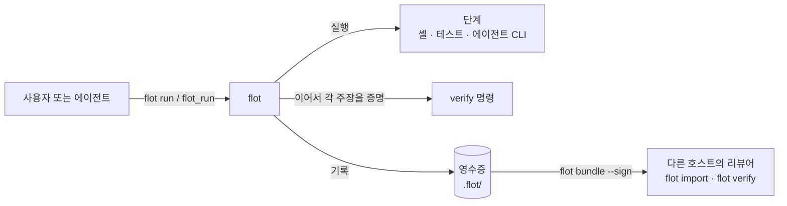

<div align="center">

[English](../../README.md) · **한국어**

# flot

### 코딩 에이전트를 위한 검증 가능한 플로우.

**에이전트는 끝났다고 말합니다. flot은 그걸 증명하는 영수증을 남깁니다.**

*flot = **flo**w + bo**t***

[](https://github.com/tobilife/flot/actions/workflows/ci.yml)
[](../../LICENSE)
[](../../Cargo.toml)
[](../architecture.md#current-scope)
[](../mcp.md)

[빠른 시작](#빠른-시작) · [flot의 동작 방식](#flot의-동작-방식) · [flot이 보장하는 것](#flot이-보장하는-것) · [예제 플로우](#예제-플로우) · [FAQ](#faq) · [문서](#문서)

<code>cargo install flot-cli</code>

</div>

---

코딩 에이전트는 성공을 말로 보고합니다. "구현했고, 테스트 전부 통과합니다." flot은
그 말을 증거로 바꿉니다. 할 일을 작은 단계(셸 명령, 테스트, 에이전트 CLI)의 플로우로
선언하면, flot이 그것을 실행하고 단계마다 내용 주소 기반 **영수증(receipt)**을
기록하며, 모든 주장(claim)을 에이전트가 작성하지 않은 명령으로 검증합니다.

규칙 하나는 프롬프트가 아니라 런타임이 강제합니다.

> **독립된 명령이 증명하기 전까지 주장은 검증되지 않은 상태입니다.**
> 증명되지 않은 주장이 있는 실행은 절대 `passed`가 될 수 없습니다.

영수증이 의존하는 것이 바뀌지 않았으면 영수증을 재사용하므로, 두 번째 실행은 비용이
들지 않습니다. 영수증은 번들로 묶고 서명해서 다른 머신의 리뷰어에게 넘길 수 있고,
리뷰어는 에이전트나 그 호스트를 믿지 않고도 검증할 수 있습니다. flot은 바이너리 하나,
`flot.toml` 하나, `.flot/` 디렉터리 하나로 동작하며, 터미널과 MCP를 지원하는 모든
에이전트에서 쓸 수 있습니다.

## 빠른 시작

### 설치

[Rust](https://rustup.rs) 1.88 이상이 필요합니다.

```bash
cargo install flot-cli
```

크레이트 이름은 `flot-cli`이고, 설치되는 명령은 `flot`입니다. 릴리스가 아닌 최신
`main`을 쓰려면 `cargo install --git https://github.com/tobilife/flot`을 사용하세요.

### 에이전트에 연결 (MCP)

```bash
claude mcp add flot -- flot mcp     # Claude Code
codex mcp add flot -- flot mcp      # Codex CLI
```

`flot.toml`이 있는 프로젝트에서 에이전트를 다시 시작하세요(`flot init`이 시작용
파일을 만들어 줍니다). 그리고 이렇게 요청해 보세요.

```text
실패하는 테스트를 고쳐줘. 끝나면 flot_run을 실행해서 결과(verdict)와
검증되지 않은 주장이 있으면 보여줘.
```

에이전트는 실행을 계획(plan), 실행(run), 조회(show), 검증(verify), 비교(diff)하는
도구를 얻습니다. 주장이 증명되지 않은 실행은 도구 오류가 아니라 `unverified`로
돌아오므로, 에이전트가 증명 누락을 일시적인 오류로 착각할 수 없습니다. 모든 도구와
그 계약은 [MCP 서버](../mcp.md) 문서에 있습니다.

### 터미널에서 사용 (CLI)

```bash
flot init        # 시작용 flot.toml 작성
flot plan        # 무엇이 실행되고, 무엇이 재사용되며, 어떤 주장에 증명이 없는지
flot run         # 실행하고 영수증 기록
flot show        # 최근 실행의 단계, 주장, 한계(limitation)
```

이 저장소는 flot으로 스스로를 검증합니다([`flot.toml`](../../flot.toml)).

```
$ flot run --force
ran      format               ok        172ms  claims 1v/0u/0r  receipt d072287e3975
ran      build                ok        775ms  claims 1v/0u/0r  receipt 009c7a066fc5
ran      lint                 ok        746ms  claims 1v/0u/0r  receipt 4c48096a2112
ran      test                 ok        5464ms  claims 2v/0u/0r  receipt 41311fb492f4

PASSED 1795501497928-ee2a0bae7a0c  root ee2a0bae7a0c  15352ms

$ flot run     # 바뀐 것이 없음: 영수증이 재사용되고 루트 다이제스트도 같음
cached   format               ok        172ms  claims 1v/0u/0r  receipt d072287e3975
cached   build                ok        775ms  claims 1v/0u/0r  receipt 009c7a066fc5
cached   lint                 ok        746ms  claims 1v/0u/0r  receipt 4c48096a2112
cached   test                 ok        5464ms  claims 2v/0u/0r  receipt 41311fb492f4

PASSED 1795501513323-ee2a0bae7a0c  root ee2a0bae7a0c  397ms
```

`1v/0u/0r`은 검증됨(verified), 미검증(unverified), 반박됨(refuted) 주장의 개수입니다.
모든 명령, 실행 지정 방법, `--json`, 종료 코드는 [CLI 레퍼런스](../cli.md)에 있습니다.

## flot의 동작 방식



단계는 무엇을 실행하고, 무엇을 읽고, 무엇을 주장하며, 그것을 어떻게 증명하는지
선언합니다.

```toml
[flow]
name = "release-candidate"
budget = { timeout_secs = 900 }

[[step]]
id = "implement"
run = "claude -p 'implement .flot-work/spec.md'"
needs = ["spec"]
inputs = [".flot-work/spec.md"]
outputs = ["src/**/*.rs"]
claims = ["the workspace still compiles after the agent's edits"]
verify = "cargo build --all-targets --quiet"
```

flot은 명령, 모든 입력 파일의 내용, 증명, 상위 단계의 영수증으로 **단계 키(step
key)**를 만듭니다. 키가 같으면 이전 영수증을 재사용하고 그 출력 파일을 복원합니다.
다르면 단계를 실행하고, 이어서 증명을 실행한 뒤, 새 영수증을 봉인합니다. 영수증 id는
일어난 일의 다이제스트이므로, 수정된 영수증은 더 이상 인증되지 않습니다. 실행 결과는
`failed`, `unverified`, `passed` 중 하나이며 이 순서로 우선합니다.

키, 영수증, 주장, 예산, 동시 실행, 출력, 보호된 증명 등 모든 필드는
[플로우 작성](../flows.md) 문서에 있습니다.

## flot이 보장하는 것

- **증명 없이는 통과 없음.** 주장은 단계가 성공한 뒤 증명 명령이 실행되어 0으로
  종료했을 때만 `verified`입니다. 실패, 시간 초과, 강제 종료, 실패 허용된 단계는
  아무것도 증명하지 않으며, 실행 중에 판단 대상 파일이 바뀐 증명도 인정되지 않습니다.
- **검증 가능한 영수증.** 모든 영수증은 다시 해시하면 자기 id가 되고, 실행의 결과와
  루트 다이제스트는 저장된 값을 읽지 않고 영수증에서 다시 계산됩니다. `flot verify`는
  저장된 모든 바이트를 다시 읽습니다.
- **믿을 수 있는 재사용.** 캐시 적중에는 같은 입력 내용과 같은 상위 영수증 위의 같은
  명령, 그리고 이 호스트의 봉인이 필요합니다. 실패는 절대 캐시되지 않습니다.
- **옮겨 다니는 증거.** `flot bundle --sign`은 리뷰어가 가져와 검증할 수 있는 파일
  하나를 만듭니다. 가져온 영수증은 리뷰어가 신뢰하는 서명자가 서명했을 때만, 그
  신뢰가 유지되는 동안만 로컬 작업을 대신합니다.
- **제한된 실행.** 시간 제한과 출력 제한은 작업을 멈추고 그 사실을 알립니다. 비용
  상한은 에이전트가 보고한 지출이 그 금액에 이르면 새 단계를 시작하지 않습니다.
- **하나의 계약.** CLI와 MCP 서버는 같은 함수를 호출하므로, 사람과 에이전트가 같은
  영수증, 결과, 다이제스트를 봅니다.

서명, 신뢰 목록, `.flot` 저장소는 [증거, 번들, 신뢰](../evidence.md) 문서에 있습니다.

## 예제 플로우

| 플로우 | 보여주는 것 |
|---|---|
| [`examples/slugify`](../../examples/slugify/flot.toml) | 에이전트 하나가 명세를 구현하고, 어떤 에이전트도 작성하지 않은 검사가 그것을 증명하며, 두 번째 에이전트가 리뷰합니다. Claude Code로 처음부터 끝까지 실행했고, [전체 이야기](../agents.md#a-real-run-end-to-end)에는 이 과정에서 flot 자체에서 찾은 버그도 있습니다. |
| [`examples/agent-review.toml`](../../examples/agent-review.toml) | 명세, 구현, 리뷰를 세 개의 에이전트 단계로 나누고, 프로젝트의 테스트가 구현을 증명합니다. |
| [`examples/parallel-review.toml`](../../examples/parallel-review.toml) | 현재 diff를 독립된 에이전트 리뷰어 세 명(보안, 성능, 계약)이 동시에 검토한 뒤 테스트 게이트를 통과합니다. |
| [`flot.toml`](../../flot.toml) | 이 저장소 자체의 게이트: 포맷, 빌드, 린트, 테스트를 각각 증명과 함께 실행합니다. |

예제는 실행하기 전에 프로젝트 루트로 복사하세요. 경로와 `.flot` 저장소는 플로우
파일 기준입니다. 에이전트 단계와 비용 집계는 [코딩 에이전트 실행](../agents.md)
문서에 있습니다.

## FAQ

<details>
<summary><strong>flot은 Claude Code나 Codex 플러그인인가요?</strong></summary>

아닙니다. flot은 독립된 바이너리입니다. 에이전트와 양방향으로 함께 동작합니다.
에이전트가 MCP로 flot을 호출하거나(`flot mcp`), flot이 단계 안에서 에이전트를
호출합니다(`claude -p …`, `codex exec …`). 훅, 프롬프트, 에이전트 정의를 설치하지
않으며, 에이전트 바깥에서 작업을 판정합니다.

</details>

<details>
<summary><strong>어떤 에이전트에서 쓸 수 있나요?</strong></summary>

stdio 방식의 로컬 MCP 서버를 지원하는 모든 에이전트, 그리고 단계 안에서 쓸 수 있는
CLI가 있는 모든 에이전트입니다. Claude Code와 Codex 등록 방법은 위에 있고, 프로토콜
세부 사항은 [MCP 서버](../mcp.md) 문서에 있습니다.

</details>

<details>
<summary><strong>flot이 실행하는 단계를 샌드박스에 가두나요?</strong></summary>

아닙니다. 단계는 사용자의 권한과 환경으로 실행됩니다. flot은 단계가 한 일을 기록하고
판정할 뿐, 가두지는 않습니다. 직접 읽어 본 플로우만 실행하고, 에이전트에게는 원래
줄 수 있는 만큼의 권한만 주세요.

</details>

<details>
<summary><strong>실행 결과가 왜 <code>unverified</code>인가요?</strong></summary>

적어도 하나의 주장이 증명으로 결론나지 않았다는 뜻입니다. 단계에 `verify` 명령이
없거나, 단계가 실패했거나 `allow_failure`로 허용됐거나, 증명이 시간 초과·강제
종료되었거나 판단 대상 파일이 바뀐 경우입니다. `flot show`는 검증되지 않은 주장을
하나씩 보여 주고, `flot plan`은 실행 전에 증명이 없는 주장을 알려 줍니다.

</details>

<details>
<summary><strong>flot이 내 코드를 어딘가로 보내나요?</strong></summary>

아닙니다. flot은 로컬에서 실행되며 네트워크 코드가 없습니다. 단계로 실행하는
에이전트는 각자의 제공자와 각자의 데이터 정책에 따라 통신합니다.

</details>

<details>
<summary><strong>Windows에서 동작하나요?</strong></summary>

아직 테스트하지 않았습니다. 프로세스 그룹 취소에 POSIX 시그널을 쓰며, CI는 Linux와
macOS에서 실행됩니다.

</details>

<details>
<summary><strong>버그를 만나면 어떻게 하나요?</strong></summary>

`cargo install flot-cli`로 업데이트한 뒤 다시 시도하세요. 그래도 재현되면 `flot --version`, 플로우 파일, 실행한 명령과 출력을 담아
[이슈를 열어 주세요](https://github.com/tobilife/flot/issues).

</details>

## 문서

문서는 영어로 작성되어 있습니다.

- [플로우 작성](../flows.md): 단계, 키, 영수증, 주장, 예산, 동시 실행, 출력, 보호된 증명.
- [CLI 레퍼런스](../cli.md): 명령, 실행과 플로우 지정, `--json`, 종료 코드.
- [MCP 서버](../mcp.md): 등록, 도구, 응답, 오류, 취소.
- [코딩 에이전트 실행](../agents.md): 에이전트 실행 전체 사례, 비용과 비용 상한.
- [증거, 번들, 신뢰](../evidence.md): 번들, 서명, 신뢰 목록, `.flot` 저장소.
- [아키텍처](../architecture.md): 계층, 강제되는 의존성 규칙, 현재 범위.

취약점은 [SECURITY.md](../../SECURITY.md)를 통해 제보해 주세요.

## 기여하기

버그 제보나 기능 제안은 [이슈](https://github.com/tobilife/flot/issues)로, 코드나 문서
개선은 [풀 리퀘스트](https://github.com/tobilife/flot/pulls)로 보내 주세요. 개발 환경과
검사 방법은 [CONTRIBUTING.md](../../CONTRIBUTING.md)에 있습니다.

## 라이선스

[MIT](../../LICENSE)
