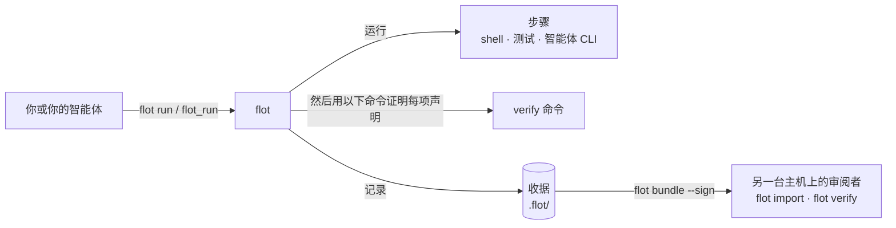

<div align="center">

[English](../../README.md) · [한국어](README_ko.md) · **中文**

# flot

### 面向编码智能体的可验证流程。

**智能体说它完成了。flot 留下能证明这一点的收据。**

*flot = **flo**w + bo**t***

[](https://github.com/tobilife/flot/actions/workflows/ci.yml)
[](../../LICENSE)
[](../../Cargo.toml)
[](../architecture.md#current-scope)
[](../mcp.md)

[为什么与何时](#为什么以及何时使用-flot) · [快速开始](#快速开始) · [工作原理](#工作原理) · [flot 的保证](#flot-的保证) · [示例流程](#示例流程) · [常见问题](#常见问题) · [文档](#文档)

<code>cargo install flot-cli</code>

最新版本 **0.2.2**：较长的步骤输出同时显示开头和结尾，`flot log` 打印完整输出，`flot diff` 比较最近两次运行，通配输入会跳过 git 忽略的文件 · [更新日志](../../CHANGELOG.md)

</div>

---

编码智能体用文字报告成功："已实现，测试全部通过。"flot 把这句话变成证据。你把要做的工作
声明为由若干步骤（shell 命令、测试套件、智能体 CLI）组成的小型流程，flot 负责执行，
为每个步骤记录一份内容寻址的**收据（receipt）**，并用一条不是智能体写的命令去检验每一项
声明（claim）。

有一条规则由运行时强制执行，而不是靠提示词：

> **在独立命令证明之前，声明始终是未验证的。**
> 存在未证明声明的运行永远不会报告 `passed`。

当收据所依赖的内容都没有变化时，收据会被复用，因此第二次运行几乎没有成本。收据可以打包、
签名并交给另一台机器上的审阅者，审阅者无需信任智能体或其主机即可检验。flot 只有一个二进制
文件、一个 `flot.toml` 和一个 `.flot/` 目录，既可以在终端中使用，也可以被任何支持 MCP 的
智能体调用。

## 为什么以及何时使用 flot

智能体说"完成了"，这是对你代码的一个声明，而每次都手动检查是坚持不下去的：重新跑测试、
翻看日志，最后仍然无法向别人展示到底什么通过了。flot 把这项检查变成工作的一部分：智能体
运行流程，流程证明每一项声明，通过的结果被记录下来，你、你的 CI 和审阅者都能再次检验。

以下场景最能体现它的价值：

- **智能体修复或构建了某样东西，并说它能用。** 结论来自不是智能体写的命令。在一次真实会话
  中，Claude Code 在新克隆的 `itoa` 仓库里拿到一个失败的流程，从记录的输出中找到失败的测试，
  修正了那个写错的数字，并从 `flot_run` 得到 `passed`，花费 $0.42。
- **智能体在循环：修改、检查、再修改。** 输入没有变化的步骤会被复用，所以反复检查几乎没有
  成本：本仓库的把关首次运行需要 16 秒，没有变化时只需 0.41 秒。设置了 `attempts = N` 的步骤
  会带着证明给出的失败信息重新运行，直到成立：在一次真实运行中，Claude Code 仅凭检查的失败输出
  找到了规格里没有写明的规则，第二次尝试通过，花费 $0.25。
- **多个智能体处理同一个变更。** 审阅者在成本上限之下并发运行，并记录每一个的花费：在
  `parallel-review` 中隔离三个审阅者后，一次运行的花费从 $3.25 降到 $0.42。
- **想知道哪个智能体最擅长某项任务。** 设置了 `candidates` 的步骤会让每个智能体或模型在各自的
  项目副本中运行，用同一个检查分别证明，并保留成立者中最便宜的一个：在一次真实运行中，
  Claude Code 和 Codex 都通过了，Codex 只报告了 token 而没有报告花费，所以保留了 $0.10 的 Claude。
- **需要别人信任这个结果。** `flot bundle` 给审阅者或另一台机器一个可以导入并验证的文件，
  `flot push` 和 `flot pull` 通过你已经在用的 git 远程仓库共享运行；认可谁的收据，由签名和
  对方自己的信任列表决定。
- **想知道两次运行之间变了什么。** `flot diff` 会逐一指出收据或状态发生变化的步骤，
  `flot search` 会从最新的运行开始，找出输出、声明或限制中提到某条消息的运行。

以下情况它并不合适：

- 只运行一次命令、不需要任何记录；
- 需要隔离不可信的代码：flot 记录并评判步骤，但不对它们做沙箱隔离；
- 需要一个 CI 服务：flot 运行在你的 CI 或终端里，并不取代它们。

## 快速开始

### 安装

需要 [Rust](https://rustup.rs) 1.88 或更高版本：

```bash
cargo install flot-cli
```

crate 名为 `flot-cli`，安装的命令是 `flot`。Linux（x86_64、aarch64）和
macOS（x86_64、arm64）的预编译二进制文件见[发布页面](https://github.com/tobilife/flot/releases/latest)。
如需最新的 `main` 而不是最新发布版，请使用
`cargo install --git https://github.com/tobilife/flot`。

### 连接你的智能体（MCP）

```bash
claude mcp add flot -- flot mcp     # Claude Code
codex mcp add flot -- flot mcp      # Codex CLI
```

在 Claude Code 中也可以改为安装插件：它注册同一个服务器，并加入一个技能，让 Claude 在说
改动可用之前先运行流程，并加入一个钩子，拒绝编辑流程文件和证明读取的文件。`flot` 需要在
`PATH` 中。

```text
/plugin install flot --marketplace tobilife/flot
```

在一次真实运行中，提示词 "The slug tests fail. Fix slug.py and tell me when the work is
done." 并没有提到 flot，装了插件的 Claude Code 2.1.330 仍然加载了该技能、调用了
`flot_run` 并报告 `passed`，花费 $0.24。要求它把证明换成 `true` 时，钩子拒绝了编辑，
Claude 也如实说明了这一点，花费 $0.23。

在包含 `flot.toml` 的项目中重启智能体（`flot init` 会生成一个起步文件）。然后可以这样问它：

```text
Fix the failing test. When you are done, run flot_run and show me the verdict
and any claim that is not verified.
```

智能体会获得用于规划、运行、查看、验证、比较和搜索运行的工具。声明未被证明的运行会以
`unverified` 返回，而不是工具错误，所以智能体不会把缺失的证明误认为偶发故障。除 `flot_run`
之外的所有工具都标记为只读；无界面运行的智能体需要事先批准 `flot_run`，参见
[审批](../mcp.md#approvals)。每个工具及其约定见 [MCP 服务器](../mcp.md)。

### 在终端中使用 flot（CLI）

```bash
flot init        # 生成起步用的 flot.toml
flot plan        # 将运行什么、复用什么、哪些声明缺少证明
flot run         # 执行并记录收据
flot show        # 最近一次运行的步骤、声明和局限
```

本仓库用 flot 把关自身（[`flot.toml`](../../flot.toml)）：

```
$ flot run --force
ran      format               ok        183ms  claims 1v/0u/0r  receipt 7c8c480702e0
ran      build                ok        876ms  claims 1v/0u/0r  receipt 2f5273d0f500
ran      lint                 ok        816ms  claims 1v/0u/0r  receipt 48a64dd4723f
ran      test                 ok        5657ms  claims 2v/0u/0r  receipt 3a0fd0619f68
    complete output: flot log test 1795521673839-85aac97d67a6

PASSED 1795521673839-85aac97d67a6  root 85aac97d67a6  16144ms
limitations:
  - test: inline output trimmed to 2048 bytes per stream; complete streams are in the store

$ flot run     # 没有任何变化：收据被复用，根摘要完全相同
cached   format               ok        183ms  claims 1v/0u/0r  receipt 7c8c480702e0
cached   build                ok        876ms  claims 1v/0u/0r  receipt 2f5273d0f500
cached   lint                 ok        816ms  claims 1v/0u/0r  receipt 48a64dd4723f
cached   test                 ok        5657ms  claims 2v/0u/0r  receipt 3a0fd0619f68

PASSED 1795521691818-85aac97d67a6  root 85aac97d67a6  412ms
```

以上输出由 flot 0.2.2 记录。第二次运行复用了全部四份收据，用时 0.41 秒而不是 16 秒；
被复用的步骤只显示记录时的耗时，不再打印其他内容。对于实际运行的步骤，flot 还会在那一行
下面打印输出的开头和结尾几行，这里省略了；`flot log test` 可以打印完整输出。

`1v/0u/0r` 分别统计已验证、未验证和被驳回的声明。所有命令、运行选择方式、`--json` 和
退出码见 [CLI 参考](../cli.md)。

## 工作原理



一个步骤声明它运行什么、读取什么、断言什么，以及如何证明：

```toml
[flow]
name = "release-candidate"
budget = { timeout_secs = 900 }

[[step]]
id = "implement"
run = "claude -p 'implement .flot-work/spec.md'"
needs = ["spec"]
inputs = [".flot-work/spec.md"]
outputs = ["src/**/*.rs"]
claims = ["the workspace still compiles after the agent's edits"]
verify = "cargo build --all-targets --quiet"
```

flot 根据命令、每个输入的内容、证明命令以及上游步骤的收据推导出**步骤键（step key）**。
键不变时，复用之前的收据并恢复其输出文件；否则运行该步骤，随后运行它的证明，并封存一份新
收据：收据 id 就是所发生事情的摘要，因此被改动的收据将无法通过认证。运行的结论按
`failed`、`unverified`、`passed` 的优先级确定。

[编写流程](../flows.md)介绍了所有字段：键、收据、声明、预算、并发、输出和受保护的证明。

## flot 的保证

- **没有证明就没有通过。** 只有当证明命令在步骤成功之后运行并以 0 退出时，声明才是
  `verified`。失败、超时、被终止或被容忍失败的步骤什么也证明不了；运行期间其文件发生变化的
  证明也不算数。
- **智能体改不了的证明。** 设置 `proofs_from = "origin/main"` 后，与该修订不同的证明
  （其命令、声明或它读取的文件）的声明保持 unverified；`flot verify --proofs-from`
  也会用同一修订检查已记录的运行。Claude Code 插件还会在编辑发生之前拒绝修改这些文件。
- **可检验的收据。** 每份收据重新哈希后都得到它自己的 id；运行的结论和根摘要从收据重新
  计算，而不是读取存储的值。`flot verify` 会重新读取每一个存储的字节。
- **可信的复用。** 缓存命中要求在相同的输入内容和相同的上游收据上运行相同的命令，并带有
  本主机的封印。失败永远不会被缓存。
- **可携带的证据。** `flot run --sign` 在记录运行的同时签名，`flot bundle` 生成一个审阅者
  可以导入并验证的文件。只有审阅者信任的签名者签过的、且仍在信任期内的导入收据，才能代替
  本地工作。更换密钥时，`flot key rotate` 写出一份由新旧两把密钥共同签名的交接声明，读者用
  `flot trust rotate` 跟随。
- **有界的运行。** 超时和输出限制会停止工作并如实说明；成本上限会在智能体报告的花费达到
  该金额后不再启动新步骤。
- **同一份约定。** CLI 和 MCP 服务器调用相同的函数，因此人和智能体看到的是相同的收据、
  结论和摘要。

签名、信任列表和 `.flot` 存储见[证据、打包与信任](../evidence.md)。

## 示例流程

| 流程 | 展示内容 |
|---|---|
| [`examples/slugify`](../../examples/slugify/flot.toml) | 一个智能体按规格实现，一个不是智能体写的检查来证明，第二个智能体审阅。已用 Claude Code 端到端运行；[完整经过](../agents.md#a-real-run-end-to-end)包括它在 flot 自身中发现的一个缺陷。智能体步骤隔离后，一次全新运行花费 $0.48。 |
| [`examples/slugify/compare.toml`](../../examples/slugify/compare.toml) | Claude Code 和 Codex 作为两个候选实现同一份规格；同一个检查分别证明它们，保留成立者中最便宜的一个。[一次真实运行](../agents.md#two-agents-on-the-same-spec)以及它发现的两个缺陷。 |
| [`examples/agent-review.toml`](../../examples/agent-review.toml) | 规格、实现和审阅三个智能体步骤；由项目自身的测试证明实现。 |
| [`examples/parallel-review.toml`](../../examples/parallel-review.toml) | 三个独立的智能体审阅者（安全、性能、约定）并发审阅当前 diff，然后经过测试把关。[一次真实运行](../agents.md#three-reviewers-in-parallel)发现了一个未写入文档的默认值；隔离智能体步骤后，一次运行的花费从 $3.25 降到 $0.42。 |
| [`flot.toml`](../../flot.toml) | 本仓库自身的把关：格式、构建、lint 和测试，每一项都有证明。 |

运行示例前请把它复制到项目根目录：路径和 `.flot` 存储都相对于流程文件。
[运行编码智能体](../agents.md)介绍了智能体步骤和花费统计。

## 常见问题

<details>
<summary><strong>flot 是 Claude Code 或 Codex 的插件吗？</strong></summary>

不是。flot 是独立的二进制文件，可以从两个方向配合任何智能体：智能体通过 MCP 调用 flot
（`flot mcp`），或者 flot 把智能体作为一个步骤调用（`claude -p …`、`codex exec …`）。它不安装
任何钩子、提示词或智能体定义，而是从智能体外部评判工作。

</details>

<details>
<summary><strong>哪些智能体可以使用 flot？</strong></summary>

任何支持通过 stdio 连接本地 MCP 服务器的智能体，以及任何有命令行界面、可以在步骤中使用的
智能体。Claude Code 和 Codex 的注册方式见上文；协议细节见 [MCP 服务器](../mcp.md)。

</details>

<details>
<summary><strong>flot 会对它运行的步骤做沙箱隔离吗？</strong></summary>

不会。步骤以你的用户权限和环境运行。flot 记录并评判步骤做了什么，但不限制它们。只运行你
读过的流程，并且只给智能体你本来就会给它的权限。

</details>

<details>
<summary><strong>为什么我的运行是 <code>unverified</code>？</strong></summary>

至少有一项声明没有得到确定的证明：步骤没有 `verify` 命令，步骤失败或通过 `allow_failure`
被容忍，或者证明超时、被终止、运行期间其文件发生了变化。`flot show` 会列出每一项未验证的
声明，`flot plan` 在运行任何东西之前就会列出缺少证明的声明。

</details>

<details>
<summary><strong>flot 会把我的代码发送到别处吗？</strong></summary>

不会。flot 在本地运行，没有任何网络代码。`flot push` 和 `flot pull` 通过运行 `git`
与你指定的远程仓库共享运行，而且只在你运行它们时才连接。作为步骤运行的智能体会按照它们
自己的数据政策与各自的服务商通信。

</details>

<details>
<summary><strong>能在 Windows 上使用吗？</strong></summary>

可以，需要安装 [Git for Windows](https://gitforwindows.org)：流程在所有平台上都按 `sh`
编写，flot 用 Git for Windows 自带的 `sh` 运行步骤。步骤及其启动的所有进程都被放进一个
Windows 作业对象（job object），所以超时或 Ctrl-C 会把它们全部停止。测试套件也在 Windows 上
运行。用 `cargo install flot-cli` 安装。Windows 没有信号，也没有可执行位：被强制终止的证明按
它得到的退出码判定；在 Linux 或 macOS 上带可执行位的文件在两边的键不同，这样的收据不会在两者
之间复用。

</details>

<details>
<summary><strong>遇到缺陷该怎么办？</strong></summary>

先用 `cargo install flot-cli` 更新后重试。如果问题仍然存在，请[提交 issue](https://github.com/tobilife/flot/issues)，
附上 `flot --version`、流程文件、你运行的命令及其输出。

</details>

## 文档

文档为英文。

- [编写流程](../flows.md)：步骤、键、收据、声明、重试（attempts）、候选比较（candidates）、预算、并发、输出和受保护的证明。
- [CLI 参考](../cli.md)：命令、选择运行和流程、`--json` 与退出码。
- [MCP 服务器](../mcp.md)：注册、工具、回复、错误和取消。
- [运行编码智能体](../agents.md)：一次端到端的智能体运行、带反馈的重试、两个智能体的比较、花费与成本上限。
- [证据、打包与信任](../evidence.md)：打包、通过 git 远程仓库共享、签名、密钥更换、信任列表和 `.flot` 存储。
- [架构](../architecture.md)：分层、强制的依赖规则和当前范围。

请通过 [SECURITY.md](../../SECURITY.md) 报告安全漏洞。

## 参与贡献

[提交 issue](https://github.com/tobilife/flot/issues) 报告缺陷或建议功能，或者
[发送 pull request](https://github.com/tobilife/flot/pulls)。开发环境和检查见
[CONTRIBUTING.md](../../CONTRIBUTING.md)。

## 许可证

[MIT](../../LICENSE)
